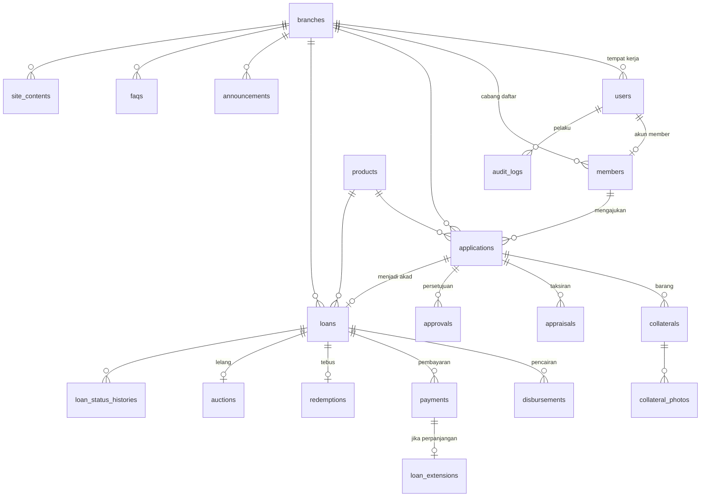
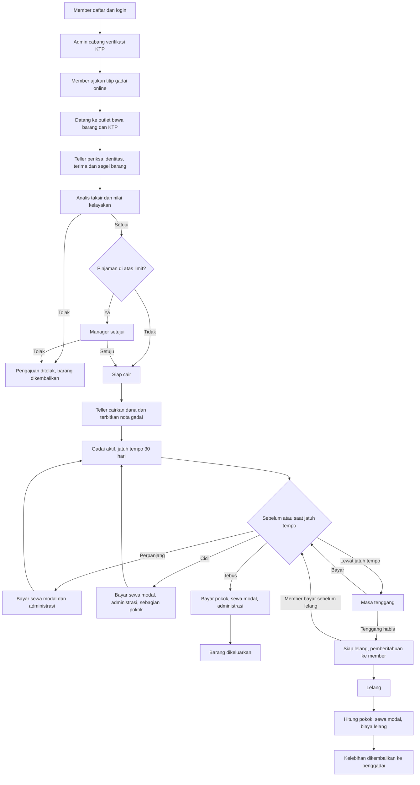
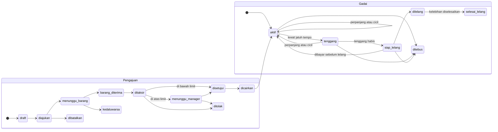

# linygadai — Rancangan Tahap 0

Status: **menunggu persetujuan**. Belum ada kode produk yang ditulis.
Tanda **[ASUMSI]** berarti angka atau aturan buatan saya sebagai placeholder. Semuanya disimpan di tabel kebijakan, bukan di kode, dan Owner bisa menggantinya dari panel.
Tanda **[VERIFIKASI]** berarti klaim hukum atau pihak luar yang harus dicek sebelum dipakai di situs.

---

## 1. Ringkasan asumsi dan arsitektur

**Yang sudah diputuskan (dari jawaban Anda)**
- Stack: Laravel + Blade + MySQL, folder `C:\XAMPP\htdocs\linygadai`.
- Angka produk, LTV, tenor, dan biaya: placeholder dari saya (lihat §1.2).
- Izin usaha: kosong. Situs tidak boleh menampilkan klaim izin sampai Admin mengisi kolomnya.
- Tagline dan identitas visual: usulan dari saya (lihat §5).

**Lingkungan terdeteksi**: PHP 8.5.12 di `C:\XAMPP\php`, Composer ada, Node v26, MySQL XAMPP ada. Ekstensi `pdo_mysql`, `mbstring`, `intl`, `fileinfo`, `gd`, `openssl`, `zip` aktif.
**Perlu keputusan Anda**: Anda memilih Laravel 11. Laravel 11 kemungkinan sudah melewati masa dukungan keamanannya per Nov 2026 **[VERIFIKASI di laravel.com/docs/releases]**. Saran saya pakai rilis Laravel stabil terbaru yang mendukung PHP 8.5. Konfirmasi di akhir dokumen.

### 1.1 Arsitektur
- **Monolit Laravel + Blade**, tanpa SPA. Halaman publik dirender server (cepat, SEO baik). Interaktivitas (kalkulator, accordion, form) memakai Alpine.js yang kecil dan Tailwind lewat Vite.
- **Peran**: satu peran per pengguna, disimpan di `users.role` (enum: owner, manager, admin, teller, analis, member) plus `users.branch_id` (null untuk Owner dan Member). Tanpa paket peran pihak ketiga. Hak akses dipetakan di `config/permissions.php` dan ditegakkan lewat Laravel Policy. Alasannya sederhana dan mudah diaudit, dan matriks Anda memang satu peran per orang.
- **Isolasi cabang**: trait `BelongsToBranch` memasang global scope `branch_id = cabang pengguna` pada semua model transaksi. Owner melewati scope itu. Member dibatasi ke datanya sendiri lewat Policy, bukan hanya lewat cabang.
- **Logika uang** ada di service murni (`LoanCalculator`, `PaymentService`, `LoanStateMachine`) yang bisa diuji tanpa HTTP. Semua perubahan status dan uang berjalan di transaksi database dan menulis `audit_logs`.
- **Uang** disimpan sebagai bilangan bulat rupiah (`bigint`), tidak pernah float.
- **Data identitas**: NIK dienkripsi (`encrypted` cast) dan punya kolom `nik_hash` (HMAC) untuk pencarian dan pencegahan duplikat. Foto KTP dan bukti ada di disk privat dan hanya diakses lewat route berotorisasi. Kata sandi di-hash (bcrypt/argon). Kredensial hanya di `.env`.
- **Pembayaran**: tunai di teller dan transfer manual (bukti diunggah, diverifikasi teller). Tanpa payment gateway pada cakupan awal **[ASUMSI]**.
- **Pengajuan online** adalah pra-pengajuan. Barang tetap harus dibawa ke outlet untuk diperiksa dan ditaksir. Tidak ada pencairan tanpa tatap muka.

### 1.2 Asumsi bisnis (placeholder, semuanya dapat diubah Owner)

| Parameter | Nilai awal [ASUMSI] |
|---|---|
| Barang diterima | Smartphone, laptop, kamera, televisi, smartwatch, konsol game |
| LTV maksimum (pinjaman ÷ taksiran) | Smartphone 80%, laptop 80%, kamera 75%, konsol 75%, TV 70%, smartwatch 70% |
| Pinjaman minimum / maksimum | Rp 100.000 / Rp 25.000.000 |
| Tenor | 30 hari, dapat diperpanjang |
| Maksimum perpanjangan berturut-turut | 3 kali, lalu wajib tebus atau taksir ulang |
| Sewa modal | 0,15% per hari dari pokok saldo, dihitung per blok 15 hari (pola yang dipakai Pegadaian untuk elektronik, angka milik kita sendiri) |
| Biaya administrasi | 1% dari pinjaman, minimum Rp 5.000, maksimum Rp 125.000, dibayar sekali per akad dan per perpanjangan |
| Cicilan minimum | Rp 50.000 di outlet |
| Masa tenggang setelah jatuh tempo | 3 hari kalender, sewa modal tetap berjalan |
| Denda uang | Rp 0 (diatur sebagai parameter, bisa diaktifkan) |
| Pemberitahuan sebelum lelang | Minimal 7 hari sejak tenggang berakhir |
| Hasil lelang | Dipakai untuk pokok, sewa modal, dan biaya lelang. **Kelebihan dikembalikan ke penggadai** |
| Limit persetujuan Manager | Pinjaman di atas Rp 5.000.000 wajib disetujui Manager. Di bawahnya, rekomendasi Analis sudah cukup |
| Penebusan oleh orang lain | Surat kuasa bermaterai, nota gadai asli, KTP asli penggadai dan penebus |
| Target pengguna | Usia 18–55, literasi digital sedang, mayoritas mobile |

### 1.3 Referensi tambahan yang dipakai
- Pegadaian: tiga jenis pembayaran (perpanjangan, cicil, tebus), sewa modal per periode, administrasi, perpanjangan membutuhkan pelunasan sewa modal, penaksiran ulang dengan setoran pokok bila taksiran turun, penebusan sebagian: [Sistem Pembayaran di Pegadaian](https://pegadaian.co.id/artikel/edukasi/sistem-pembayaran-dan-bunga-di-pegadaian), [Biaya Perpanjang Gadai](https://pegadaian.co.id/artikel/keuangan/biaya-perpanjang-gadai-di-pegadaian), [Gadai Elektronik](https://pegadaian.co.id/artikel/keuangan/gadai-elektronik), [Cara bayar, cicil, perpanjang, tebus](https://pegadaian.co.id/artikel/inspirasi/ketahui-cara-bayar-cicil-perpanjang-dan-tebus-gadai-di-pegadaian).
- Regulasi (hanya sebagai penanda untuk diverifikasi, bukan klaim hukum): OJK menyatakan perusahaan pergadaian dilarang mengambil margin dari hasil lelang dan kelebihan dikembalikan ke nasabah ([Warta Ekonomi](https://wartaekonomi.co.id/read610567/ojk-larang-perusahaan-pergadaian-ambil-margin-dari-hasil-lelang-jaminan)). Ada POJK 39/2024 tentang Pergadaian yang diubah POJK 29/2025 ([siaran pers OJK](https://ojk.go.id/id/berita-dan-kegiatan/siaran-pers/Pages/Perkuat-Ekonomi-Kerakyatan-OJK-Sederhanakan-Aturan-Baru-Pergadaian.aspx)). **[VERIFIKASI]** isi pasalnya, syarat izin, dan modal minimum dengan konsultan hukum sebelum beroperasi.
- Raja Gadai: pencarian saya tidak menemukan halaman situs mereka. Alur 3 langkah, keunggulan, dan topik FAQ yang saya pakai berasal dari ringkasan di brief Anda, **belum saya verifikasi langsung ke situsnya**. Semua teks ditulis ulang dengan kata sendiri.

---

## 2. ERD dan skema database

### 2.1 ERD



### 2.2 Tabel (kunci, relasi, indeks)

Konvensi: `id` bigint PK; `created_at`/`updated_at`; uang `bigint` rupiah; `branch_id` FK `branches.id` pada semua tabel transaksi. Soft delete hanya pada data konten, tidak pada data uang.

| Tabel | Kolom utama | Kunci dan indeks |
|---|---|---|
| `branches` | kode (A,B,PUSAT), nama, alamat, telepon, whatsapp, email, lat, lng, jam_buka, is_active | UNIQUE(kode) |
| `users` | name, email, password(hash), role(enum), branch_id null, status(aktif/nonaktif), last_login_at, remember_token | UNIQUE(email); FK branch_id; INDEX(role, branch_id) |
| `members` | user_id, branch_id, nama_lengkap, nik_enc, nik_hash, tgl_lahir, alamat, telepon, ktp_path, status(calon/terverifikasi/ditolak/blokir), verified_by, verified_at | UNIQUE(user_id), UNIQUE(nik_hash); INDEX(branch_id,status) |
| `products` | branch_id null(=semua), nama, slug, kategori_barang, deskripsi, pinjaman_min, pinjaman_max, ltv_max_persen, tenor_hari, sewa_modal_per_hari_bp, blok_hari, admin_persen_bp, admin_min, admin_max, urutan, is_active | UNIQUE(slug); INDEX(is_active, urutan) |
| `policy_settings` | key, value(json), berlaku_mulai, diubah_oleh | INDEX(key, berlaku_mulai) |
| `applications` | kode, member_id, branch_id, product_id, pinjaman_diminta, tenor_hari, status, catatan_member, diajukan_at, batas_bawa_barang, created_by | UNIQUE(kode); INDEX(branch_id,status), INDEX(member_id) |
| `collaterals` | application_id, branch_id, jenis, merek, model, imei_serial_enc, imei_serial_hash, kelengkapan, kondisi, no_segel, lokasi_simpan, diterima_oleh, diterima_at, status(diterima/tersimpan/dikeluarkan/dilelang) | INDEX(imei_serial_hash) untuk cek barang ganda; INDEX(branch_id,status) |
| `collateral_photos` | collateral_id, path, jenis(depan/belakang/serial/segel) | FK collateral_id |
| `appraisals` | application_id, analis_id, tipe(awal/ulang), nilai_pasar, nilai_taksiran, ltv_diterapkan_bp, plafon_maks, skor_kelayakan, rekomendasi(setuju/tolak/revisi), catatan, is_current | INDEX(application_id, is_current) |
| `approvals` | application_id, level(analis/manager), keputusan, oleh, catatan, decided_at | INDEX(application_id) |
| `loans` | no_sbg, application_id, member_id, branch_id, product_id, pokok_awal, pokok_saldo, tgl_akad, jatuh_tempo, tenggang_sampai, perpanjangan_ke, snapshot_syarat(json), status | UNIQUE(no_sbg), UNIQUE(application_id); INDEX(branch_id,status,jatuh_tempo), INDEX(member_id) |
| `disbursements` | loan_id, branch_id, jumlah, metode(tunai/transfer), referensi, teller_id, dicairkan_at | FK loan_id |
| `payments` | no_kwitansi, loan_id, branch_id, tipe(perpanjangan/cicil/tebus), sewa_modal, administrasi, denda, pokok_dibayar, total, metode(tunai/transfer), bukti_path, status(menunggu_verifikasi/sah/batal), teller_id, dibayar_at | UNIQUE(no_kwitansi); INDEX(loan_id), INDEX(branch_id,dibayar_at) |
| `loan_extensions` | loan_id, payment_id, jatuh_tempo_lama, jatuh_tempo_baru, ke | UNIQUE(payment_id) |
| `redemptions` | loan_id, payment_id, penebus_tipe(penggadai/kuasa), nama_penebus, nik_penebus_enc, surat_kuasa_path, nota_asli_diperiksa, dikeluarkan_oleh, dikeluarkan_at | UNIQUE(loan_id) |
| `auctions` | loan_id, collateral_id, status(dijadwalkan/laku/tidak_laku), diberitahukan_at, tgl_lelang, harga_limit, harga_laku, biaya_lelang, kelebihan, kelebihan_status(belum/dibayarkan), disetujui_oleh | UNIQUE(loan_id) |
| `loan_status_histories` | loan_id, dari, ke, oleh, alasan | INDEX(loan_id) |
| `audit_logs` | user_id, branch_id, aksi, subject_type, subject_id, sebelum(json), sesudah(json), ip, user_agent | **Append-only** (tanpa update/delete di aplikasi); INDEX(subject_type,subject_id), INDEX(user_id,created_at) |
| `announcements` | branch_id null, judul, isi, mulai, selesai, is_published, dibuat_oleh | INDEX(is_published, mulai) |
| `faqs` | branch_id null, pertanyaan, jawaban, urutan, is_published | INDEX(is_published, urutan) |
| `site_contents` | branch_id null, kunci(sambutan, ringkasan, standar_layanan, panduan_*, izin_usaha, kontak, sosmed, peta), nilai(json/teks) | UNIQUE(branch_id,kunci) |

**Aturan integritas**
- `loans.pokok_saldo >= 0`; `pokok_saldo <= pokok_awal`; dicek di service dan lewat CHECK constraint.
- `loans.snapshot_syarat` menyimpan tarif yang berlaku saat akad, jadi perubahan kebijakan tidak mengubah akad berjalan.
- Satu pembayaran `sah` tidak boleh diubah. Koreksi dilakukan dengan pembayaran pembalik yang dicatat di audit.
- Migrasi dan seeder (2 cabang, kantor pusat, satu pengguna per peran per cabang, produk contoh, konten awal) ditulis di Tahap 1.

---

## 3. Alur proses dan status

### 3.1 Alur end-to-end



### 3.2 State machine



Aturan perpindahan status hanya lewat `LoanStateMachine`. Setiap perpindahan menulis `loan_status_histories` dan `audit_logs`. Transisi `aktif → tenggang → siap_lelang` dijalankan scheduler harian. Transisi ke `dilelang` butuh persetujuan Manager.

---

## 4. Matriks hak akses

Keterangan: **✓** diizinkan; **C** hanya miliknya sendiri; **—** tidak diizinkan. Cakupan: Owner semua cabang; Manager, Admin, Teller, Analis hanya cabangnya; Member hanya datanya.

| Modul | Aksi | Owner | Manager | Admin | Teller | Analis | Member |
|---|---|:-:|:-:|:-:|:-:|:-:|:-:|
| Pengguna & peran | lihat / tambah / ubah / nonaktifkan | ✓ | — | — | — | — | — |
| Cabang | lihat / ubah | ✓ | lihat | — | — | — | — |
| Kebijakan & produk | lihat | ✓ | ✓ | ✓ | ✓ | ✓ | publik |
| Kebijakan & produk | ubah tarif, LTV, limit | ✓ | — | — | — | — | — |
| Produk (konten kartu) | ubah deskripsi, urutan | ✓ | — | ✓ | — | — | — |
| Anggota | lihat | ✓ | ✓ | ✓ | ✓ | ✓ | C |
| Anggota | verifikasi, ubah, blokir | ✓ | — | ✓ | — | — | ubah profil C |
| Pengumuman, FAQ, konten situs | lihat / buat / ubah / terbitkan | ✓ | lihat | ✓ | — | — | — |
| Pengajuan | buat | — | — | — | ✓ (atas nama) | — | ✓ C |
| Pengajuan | lihat | ✓ | ✓ | ✓ | ✓ | ✓ | C |
| Penerimaan barang jaminan | catat, segel, foto | — | — | — | ✓ | — | — |
| Penaksiran | buat, rekomendasi | — | — | — | — | ✓ | — |
| Penaksiran | lihat | ✓ | ✓ | — | ✓ | ✓ | ringkasan C |
| Persetujuan | setujui/tolak ≤ limit | — | ✓ | — | — | rekomendasi | — |
| Persetujuan | setujui/tolak > limit | ✓ (override) | ✓ | — | — | — | — |
| Pencairan | catat | — | — | — | ✓ | — | — |
| Pembayaran | catat perpanjang / cicil / tebus | — | — | — | ✓ | — | — |
| Pembayaran | verifikasi transfer | — | ✓ | — | ✓ | — | — |
| Pembayaran | pembatalan / pembalikan | — | ✓ | — | — | — | — |
| Pengeluaran barang (tebus) | catat | — | — | — | ✓ | — | — |
| Lelang | jadwalkan, setujui | ✓ | ✓ | — | — | — | — |
| Lelang | catat hasil | — | ✓ | — | ✓ | — | — |
| Gadai berjalan | lihat, jatuh tempo, riwayat bayar | ✓ | ✓ | lihat | ✓ | lihat | C |
| Laporan cabang | lihat, ekspor | ✓ | ✓ | — | harian sendiri | — | — |
| Laporan konsolidasi | lihat, ekspor | ✓ | — | — | — | — | — |
| Audit log | lihat | ✓ | cabang | — | — | — | — |

Catatan keamanan peran: Owner tidak mencairkan atau menerima uang sehari-hari (pemisahan tugas). Tidak ada yang bisa menyetujui pengajuan yang ia buat sendiri. Teller yang mencatat pembayaran tidak bisa membatalkannya. Perubahan peran hanya oleh Owner dan selalu masuk audit.

---

## 5. Arah desain

**Konsep**: "nota gadai" yang hangat dan tertib. Kertas, tinta, segel kuningan. Kesan: dapat dipercaya, bukan bank dingin dan bukan toko murah. Referensi visualnya adalah nota fisik, label segel barang, dan buku kas, bukan dashboard SaaS.

**Palet terbatas** [ASUMSI, bisa diganti]
| Peran | Warna |
|---|---|
| Tinta (teks, header gelap) | `#1B2A2F` |
| Kertas (latar) | `#F4EFE6` |
| Kuningan (aksen utama, tombol) | `#B8862B` |
| Lumut (sukses, aman) | `#3E5C4A` |
| Terakota (peringatan jatuh tempo) | `#B5472E` |
Hanya lima warna ini ditambah turunan terang/gelapnya. Tidak ada gradien dekoratif. Rasio kontras teks minimal 4,5:1.

**Tipografi** (di-host sendiri lewat Fontsource agar ringan dan tidak bergantung pihak ketiga)
- Judul: **Fraunces** (serif variabel berkarakter).
- Isi dan antarmuka: **Instrument Sans**.
- Nominal, nomor nota, kode: **IBM Plex Mono** dengan angka tabular agar rata.

**Grid dan ritme**: 12 kolom, rata kiri, tata letak editorial yang sengaja tidak simetris (kolom teks sempit di samping blok data lebar). Skala spasi 4/8/12/20/32/56/96 supaya jarak antarbagian berirama, bukan seragam. Mobile dahulu, sentuhan minimal 44 px.

**Prinsip komponen**
- Hasil simulasi tampil sebagai **nota** bergaris sobekan: pokok, sewa modal, administrasi, total tebus. Ini fungsional sekaligus penanda identitas.
- Kartu produk berbeda ukuran dan tanpa bayangan berlapis. Pembeda dengan garis tipis dan label segel pada kategori barang.
- Status gadai memakai teks + ikon + warna (tidak hanya warna). Jatuh tempo ditampilkan sebagai hitung mundur hari.
- Panel staf rapat dan berbasis tabel, sidebar ramping, dengan aksi utama satu per layar.
- Mikro-interaksi fungsional saja: accordion mulus, angka simulasi berubah halus, penanda fokus jelas, status simpan tombol. Hormati `prefers-reduced-motion`.
- Ilustrasi: garis SVG buatan sendiri (label segel, nota, kotak barang). Foto kantor dan staf asli menunggu dari Anda, tanpa stok foto generik. Tanpa emoji dekoratif.
- Bahasa sederhana, tanpa istilah teknis tanpa penjelasan ("sewa modal" disertai arti singkat).

**Usulan tagline** (pilih satu atau beri sendiri)
1. "Titip hari ini, tenang sampai tebus."
2. "Barang aman, dana cepat, aturan jelas."
3. "Gadai yang menjelaskan semuanya."

**Daftar hindari (diperiksa setiap halaman)**: gradien ungu-biru, kartu seragam berbayangan, emoji dekoratif, tata letak simetris monoton, ikon stok generik, teks lorem.

**SEO publik**: HTML semantik, satu `h1`, meta dan Open Graph per bagian, JSON-LD `FinancialService`/`LocalBusiness` (alamat dan koordinat dari data kontak), gambar `webp` dengan `alt` dan lazy-load, FAQ memakai markup `FAQPage`, sitemap dan robots. Tanpa klaim izin sampai kolomnya diisi.

---

## 6. Struktur folder (ringkas)

```
linygadai/
├─ app/
│  ├─ Enums/            Role, LoanStatus, ApplicationStatus, PaymentType
│  ├─ Models/Concerns/  BelongsToBranch, Auditable
│  ├─ Policies/         satu per model
│  ├─ Services/         LoanCalculator, PaymentService, LoanStateMachine, AuctionService
│  ├─ Http/Controllers/ Public/, Member/, Staff/{Admin,Teller,Analis,Manager,Owner}/
│  └─ Console/          scheduler jatuh tempo, tenggang, pengingat
├─ config/permissions.php
├─ database/{migrations,seeders}
├─ resources/views/{public,member,staff,layouts,components}
├─ routes/{web.php,member.php,staff.php}
├─ storage/app/private/ (KTP, bukti, surat kuasa)
├─ tests/{Feature,Unit}
└─ docs/
```

## 7. Rencana tahap berikutnya (tiap tahap berhenti untuk konfirmasi)

| Tahap | Isi | Bisa diuji sendiri lewat |
|---|---|---|
| 1 | Install Laravel, migrasi semua tabel, seeder 2 cabang dan 6 peran, login, middleware peran dan cabang, audit log | Login tiap peran, uji isolasi cabang |
| 2 | Halaman publik: nav, beranda, produk, panduan, simulasi, tentang, masuk/daftar | Kalkulator vs `LoanCalculator`, Lighthouse, mobile |
| 3 | Member dan pengajuan, Admin (anggota, konten), Teller terima barang, Analis taksir, Manager setuju | Satu pengajuan sampai siap cair |
| 4 | Pencairan, perpanjang, cicil, tebus, tenggang, lelang, scheduler | Skenario uang dengan uji unit |
| 5 | Laporan cabang dan konsolidasi, audit viewer, penguatan keamanan, checklist akhir | Checklist fungsional, hak akses, keamanan, responsif |

---

## 8. Yang saya butuhkan dari Anda sebelum Tahap 1

1. Versi Laravel: pakai rilis stabil terbaru yang mendukung PHP 8.5 (saran saya), atau tetap Laravel 11?
2. Apakah asumsi bisnis di §1.2 boleh jadi nilai awal? Sebutkan angka yang ingin diubah.
3. Pilihan tagline (§5) dan apakah palet kertas-tinta-kuningan cocok.
4. Apakah pemisahan tugas di §4 (Owner tidak mencatat transaksi harian; Manager yang membatalkan pembayaran) sesuai kebijakan Anda?
